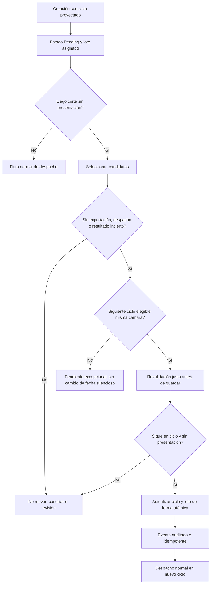

# ACH-CR-001 — Arquitectura de solución

## 1. Problema y enfoque mínimo

Hoy la creación guarda `AchTransaction.AchCycleId`, `AchBatchId` y `EffectiveEntryDate`. Si el ciclo estimado vence sin que una transacción saliente haya sido presentada, queda asociada a una oportunidad pasada. Se propone **reevaluación controlada de operaciones no presentadas**, preservando identificador, cámara, monto, trazabilidad y restricciones.

**Decisión arquitectónica:** conservar la asignación inicial, agregar una operación explícita de reasignación **antes del despacho** y auditarla con estructuras ya existentes. No rediseñar la creación, el motor NACHA, el modelo de liquidación ni el circuito de devoluciones.

**Distinción funcional obligatoria:**

1. `Proyectada`: `AchCycleId` señala oportunidad prevista; no significa envío.
2. `Exportada`: existe `AchFileExportTransaction`; presumir no elegible hasta resolución comprobable de ciclo de vida.
3. `Transmitida / en duda`: prohibido reapresentar automáticamente hasta conciliación externa.
4. `Rechazada / devuelta / compensada`: NO es traslado de pendiente. Tratar por flujo y causales propios.

El estado `AchTransferStateEnum.Pending` es insuficiente por sí solo; es solo uno de los filtros.

## 2. Decisiones aprobadas para implementar progresivamente

- **D-01:** reasignar solo transacciones salientes ordinarias no exportadas y sin despacho o efecto financiero previo durante el primer alcance. Las excepciones/contingencias requieren evidencia y etapa separada.
- **D-02:** mantener **misma cámara** al buscar siguiente ciclo. `IRoutingStrategyService` puede elegir por preferencias entre cámaras; no reutilizarlo ciegamente para cambiar la cámara de una instrucción existente.
- **D-03:** utilizar `ICycleTransactionPolicy`, calendario operativo, `IOperationalCycleWindowResolver`, configuración vigente y repositorio de ciclos antes de crear reglas paralelas.
- **D-04:** utilizar `AchTransactionStateEvent` (`ReasonCode`, `PayloadJson`, `IdempotencyKey`) para registrar `fromCycle`, `toCycle`, lotes, motivo, fecha UTC y número de intento. El evento puede tener `FromState == ToState == Pending`: se audita un cambio de asignación, no necesariamente de estado financiero.
- **D-05:** **no crear por defecto** tabla `AchTransactionCycleReassignment`, columnas ni migraciones. Si los eventos y controles existentes no permiten una garantía requerida, documentar evidencia y aprobar el cambio mínimo antes de agregar persistencia.
- **D-06:** no modificar ni reutilizar `CenitCycleQueue` como cola transversal de ACH Colombia; corresponde a un caso CENIT. El motor CENIT de liquidez seguirá aplicando su propia regla regulada.
- **D-07:** no agregar microservicio, bus, repositorio genérico, `UnitOfWork` duplicado, cron paralelo ni infraestructura de locking distribuido.
- **D-08:** sin entrega a producción automática ni operación real desde este entorno. Activación controlada y verificaciones operacionales corresponden a otra evidencia.

## 3. Capas y responsabilidades (Clean Architecture)

| Capa | Cambios mínimos previstos | Prohibiciones |
|---|---|---|
| **Domain** | Reutilizar `AchTransaction`, `AchCycle`, `AchBatch`, enums, eventos; añadir regla pura solo si aparece una invariante independiente | Dependencia EF, Quartz, servicios externos o formatos NACHA |
| **Application** | Contrato/caso de uso compacto `IAchPendingCycleReassignmentService` y, solo si evita duplicación, tipo resultado/criterio de elegibilidad | Consultas EF, cron, HTTP, archivos o `DbContext` |
| **Persistence** | Implementación del caso con `AchDbContext`, políticas existentes, operación atómica con concurrencia optimista, auditoría | Regla regulatoria hardcodeada o duplicación del routing |
| **Quartz** | Reutilizar `ITaskHandler` / `DynamicJob`; adaptador delgado que invoca el caso y registra resumen | Algoritmo de decisión dentro del handler |
| **API / SPA** | No requerido para MVP; solo consulta/observación si una necesidad existente lo demanda | Endpoint administrativo prematuro o nueva pantalla sin caso de uso |

El nombre concreto de la interfaz se fijará en I01 al contrastar convenciones y contratos reales. No incorporar interfaces auxiliares si un servicio cohesivo basta. `TimeProvider` existente es reloj inyectable.

## 4. Flujo propuesto



**Precedencia:** el filtro inicial identifica candidatos pero no autoriza el cambio. Debe existir una comprobación final antes de confirmar para evitar carreras con exportadores/dispatch. El diseño de la carrera y el mecanismo de confirmación se debe contrastar con las escrituras existentes del exportador (I01–I03); no afirmar seguridad por una simple consulta `AnyAsync`.

## 5. Algoritmo / pseudocódigo de aplicación

```text
para cada ciclo vencido de la cámara, en lote acotado:
    candidatos = transacciones salientes pending de ese ciclo
    para cada candidato:
        cargar evidencias (archivo, despacho, resultado, cola CENIT)
        si evidencia ausente o ambigua => NO_MOVER + observación
        si tiene cualquier presentación externa => NO_MOVER
        resolver próximo ciclo SAME_CHAMBER posterior al actual, en calendario vigente
        validar admisibilidad: tipo, naturaleza, servicio, política, corte y fecha valor
        si ningún ciclo válido => NO_MOVER / pendiente de gestión
        guardar de manera atómica:
            corroborar ciclo y no-presentación contra escrituras concurrentes
            resolver/crear lote destino con claves existentes
            actualizar AchCycleId, AchBatchId y vínculos dependientes aplicables
            ajustar totales de lotes si el flujo realmente los materializa
            registrar evento de cambio con clave idempotente
        informar MOVED o SKIPPED con motivo estable
```

**Importante:** el servicio **no cambia de cámara**, tipo de transacción, cuenta, monto, clasificación, TraceNumber ni adendas. `EffectiveEntryDate` se conserva si se mantiene fecha valor y el ciclo la admite. El cambio de día/fecha valor se tratará en I04 tras contrastar reglas/contrato de originación; nunca es un simple `AddDays(1)`.

## 6. Consistencia, idempotencia y concurrencia sin sobreingeniería

- Guardar la reasignación en una transacción EF dentro del mismo `AchDbContext` cuando corresponda; evita ciclo cambiado sin evento de auditoría.
- Incorporar comprobación optimista `Id` + `AchCycleId` esperado y revalidación de evidencia de exportación/despacho en el punto de confirmación. Si hay carrera, **skip** y no cambiar. Coordinar el protocolo de escritura con exportación y dispatch; si no se puede demostrar ausencia de doble presentación, limitar el alcance sin bloquear el proyecto.
- Clave lógica de intento: `ACH-CR-001:{TransactionId}:{FromCycleId}:{ToCycleId}` o clave equivalente con semántica estable; revisar restricciones persistentes existentes antes de imponer índice nuevo. Un mismo ciclo origen no debe producir dos eventos equivalentes.
- Cuando el proceso falle antes del commit, ningún estado parcial debe persistir. Al reejecutar, consultar estado actual y no volver a transferir si ya pasó al destino.
- Recalcular o sincronizar `AchBatch` y `ContrapartidaDispatchItem` **solo si existen y aplica al flujo**; prohibido copiar reglas de liquidez CENIT a cualquier transacción.
- Si hay archivo NACHA `PUBLISH` o cualquier `AchFileExportTransaction`, denegar en el MVP. La invalidación explícita de un archivo **no** queda autorizada por este diseño.
- Nunca imprimir datos bancarios personales o cuentas en logs; usar IDs técnicos, motivo y correlación.

## 7. Punto de entrada operacional

**Preferencia:** invocación idempotente en el borde previo a la selección del próximo ciclo para despacho y, en una etapa posterior, un `ITaskHandler` Quartz recuperador para pendientes vencidos. Primero resolver bien el caso de uso; luego automatizarlo. No modificar `AchCycleSchedulerHandler` con lógica transaccional ajena a su responsabilidad.

Definir el corte por ventana del ciclo/configuración de cámara (no por medianoche ni hora UTC fija). Escanear solo ciclos con `ProcessingDate` razonable y con paginación/límite configurable a través de parámetros existentes de job.

## 8. Compatibilidad con CENIT y ACH Colombia

- **ACH Colombia V35:** régimen de 5 ciclos como base vigente en el proyecto; la alternativa de 7 figura inactiva / no activable (fuente candidata insuficiente). Las políticas deben consultarse dinámicamente. No activar la candidata por construir esta función.
- **CENIT:** 5 ciclos y ventanas documentadas. El traslado por liquidez ciclos 1–3 que ya realiza `LiquidityOptimizationService` **no es** el mismo caso que una salida pendiente de transmisión. Evitar ejecutar la nueva política sobre transacciones que pertenecen a decisiones de compensación/liquidación, `CenitCycleQueue` o ejecuciones iniciadas.
- **Transacciones rechazadas/devueltas:** se excluyen del MVP y requieren tratamiento por causal/cámara. No inferir reenvío a partir de que un operador ACH no haya aceptado un archivo.

## 9. No-go's arquitectónicos

1. Enviar dos veces porque no llegó acuse.
2. Cambiar ciclo mientras exportación/dispatch genera evidencia de presentación.
3. Alterar reglas ACH Colombia o CENIT con `if` hardcodeado por número de ciclo cuando hay política versionada.
4. Crear un segundo sistema de reloj, jobs, estados o auditoría.
5. Interpretar `Pending` como ausencia de efectos financieros.
6. Migración innecesaria por comodidad de consulta.
7. Cambiar `EffectiveEntryDate` sin política/aceptación de negocio.
8. Reclamar compilación/UAT/producción con solo inspección estática.

## 10. Reglas de evolución

Modificar este documento únicamente cuando el código inspeccionado invalide una hipótesis o un incremento apruebe una decisión nueva. Registrar cada diferencia en `CHANGELOG.md` y en `MEMORY_STATE.md`. No reabrir decisiones generales del repositorio sin evidencia contraria.


## 11. Arquitectura implementada en I01 (as-built 2026-10-25)

**Único servicio nuevo**: `IAchPendingCycleEligibilityService` (Application), implementado por `AchPendingCycleEligibilityService` (Persistence con `[Scoped]` y convención Scrutor) que devuelve `AchPendingCycleEligibilityResult` inmutable (Application). Reutiliza sin modificarlos `ICycleTransactionPolicy`, `IOperationalCalendarService`, `IOperationalCycleWindowResolver`, `TimeProvider` y los `DbSet` existentes. Consulta `AsNoTracking`; no hay comando, migración, tarea programada o efectos monetarios.

Reglas implementadas/limites explícitos: **saliente CFA, clasificada, Pending, mismo día y cámara, origen vencido, sin evidencia de exportación/dispatch/netting/cola CENIT**, política destino vigente. Los archivos salientes se registran en el flujo MFT con `ExportKind="NACHA"`; no confundir con `PUBLISH` de snapshots de configuración. Por precaución se detectan ambas etiquetas cuando faltan membresías. Un positivo es **propuesta**, no autorización: una futura reasignación debe revalidar en I02 bajo protocolo compatible con exportación concurrente.

El escenario de creación sábado -> lunes se ha estudiado: `BatchResolver` aún lanza excepción de ventana `Before` para ACH Colombia cuando el ciclo futuro no está abierto. I01 no altera creación; riesgo confirmado y anotado para un siguiente incremento focal. La selección cross-day y cambios de `EffectiveEntryDate` quedan en I04. Ver `07_I01_IMPLEMENTACION_Y_EVIDENCIA.md`.


## 12. Arquitectura implementada I02 — cambio de ciclo persistido (2026-10-25)

- **Application:** `IAchPendingCycleReassignmentService.ReassignAsync(id)` y `AchPendingCycleReassignmentResult` (sin EF ni referencia a Infrastructure).
- **Persistence:** `[Scoped] AchPendingCycleReassignmentService` reutiliza la elegibilidad I01, `IAchBatchRepository.FindForTransactionAsync/AddAsync`, `ITransactionPersister.UpdateBatchTotalsAsync/UpdateBatchServiceClassCodeAsync`, `AchTransactionStateEvent` y `AchDbContext`. Cero nuevo schema / migración.
- **Atomicidad prevista:** ejecución en `ExecutionStrategy` EF + `BeginTransactionAsync(IsolationLevel.Serializable)`, con evaluación I01 dentro de la transacción. Múltiples `SaveChangesAsync` son escrituras de la misma transacción, `CommitAsync` único. Antes de entrar, el comando rechaza cambios pendientes en el contexto y, si falla un intento relacional, limpia el tracking para evitar reintentos con entidades ya aceptadas localmente pero revertidas en BD. Una invocación modifica una transacción, lote origen/destino y evento en la misma operación relacional. No se alteran estado financiero ni `StateChangedAtUtc`.
- **Idempotencia:** elegibilidad se revalida y segundo intento no cambia un ciclo ya movido. `AchTransactionStateEvent.IdempotencyKey` incorpora ID de transacción y ciclos antes/después; se consulta en la misma transacción. El índice de unicidad de eventos no se modifica.
- **Consistencia con lotes:** la búsqueda usa llave existente (ciclo + identificadores de empresa + descripción + fecha valor), pero no reutiliza un lote con clase, ID de descripción u ODFI divergentes: fail-closed. Totales y clase se recalculan con el servicio existente.
- **Riesgo abierto:** un exportador que leyó la asignación ANTES del commit puede generar fuera de transacción con datos obsoletos. Aislamiento `Serializable` del comando solo **no elimina** esa carrera. Es necesaria coordinación del borde exportador en I05 antes de permitir automatización de producción; I03 debe conservar el job deshabilitado por defecto. No declarar protección end-to-end sin ejecución adversarial en SQL Server/PostgreSQL.
- **Pruebas:** 8 casos xUnit nuevos, no ejecutados. InMemory ejercita lógica únicamente; aislamiento, rollback, carreras y restricciones de proveedor requieren pruebas relacionales. Detalle `08_I02_IMPLEMENTACION_Y_EVIDENCIA.md`.

## I03 — As-built del adaptador Quartz, sin activación operativa

- **Adaptador infraestructura** `AchPendingCycleReassignmentHandler` implementa `ITaskHandler` en Persistence, usa `AchDbContext` únicamente para **preselección de ids**, y delega cada mutación al contrato de Application `IAchPendingCycleReassignmentService` de I02. No se traslada ninguna regla bancaria al scheduler.
- **Composición existente:** `SchedulerTaskCatalog`, `TaskDefinitionSeeder`, `DynamicJobExecutor`, `SchedulerSyncService`, `NonConcurrentDynamicJob` y DI por Scrutor. Aislamiento entre ejecución Quartz (registro `TaskExecutionLog`) y evento de negocio I02 (`AchTransactionStateEvent`).
- **Fail-closed por defecto:** task persistida como `Disabled`, manual deshabilitado y flag de configuración `AchCycleReassignment:EnableExecution` ausente/false. Deben cambiarse expresamente ambos para ejecutar; no hacerlo antes de I05.
- **Límites:** máximo configurable de transacciones trasladadas y escaneadas con paginación keyset; TZ/cutoff externo se resuelve con servicio ya existente. La reevaluación I01 ocurre dentro del comando I02.
- **Limitación:** no se añade `[DisallowConcurrentExecution]` al handler, dado que no es `IJob`; `ConcurrencyPolicy=SkipIfRunning` es la configuración utilizada en el scheduler. No hay coordinación garantizada con exportación/dispatch ajenos hasta I05.
- **Riesgo de backlog:** topes de escaneo sin cursor entre ejecuciones podrían reexaminar un prefijo inelegible. I03 no introduce checkpoint persistente; se documenta y medirá antes de añadir complejidad.

La implementación de I03 se detalla en `09_I03_IMPLEMENTACION_Y_EVIDENCIA.md`. Ninguna evidencia runtime fue obtenida aquí.

## 15. I04 as-built — fecha operativa y valor sin rollover silencioso

`RoutingStrategyService` ya convierte a hora operativa local y llama `IOperationalCalendarService.GetNextBusinessDayAsync` para originación. Ahora también omite sesiones Closed/Cancelled.

En `BatchResolver` se mantiene la fecha valor calculada a partir de `AchCycle.ProcessingDate`; se incorpora `IOperationalCalendarService` inyectable (con alternativa local ya existente) y se valida que el ciclo proyectado sea hábil. Si está `Before`, **solo** se admite su asignación si `window.LocalNow.Date` es estrictamente anterior a `cycle.ProcessingDate.Date`. El caso `Before` del mismo día y `After` sigue rechazado. La política de tipo por ciclo (`ICycleTransactionPolicy`) no se omite.

La ruta CENIT de cola `MustQueueForTargetCycle` no se cambia; chequeos de estado y calendario adicionales de I04 en `BatchResolver` se ejecutan solo para cámaras diferentes de CENIT.

La reasignación posterior sigue cubierta por I01/I02: mismo `EffectiveEntryDate` y misma `ProcessingDate`; si el último ciclo venció, se devuelve `NO_ELIGIBLE_TARGET_SAME_VALUE_DATE` sin mutación. El permiso para reprogramar fecha valor distinta permanece pendiente de producto/compliance y **no** se fabrica una autorización.

Sin Domain nuevos, EF schema nuevo, migraciones, endpoints ni trabajos Quartz nuevos. La tarea I03 sigue deshabilitada. RIESGO I05: exportador simultáneo no coordinado.

## I05 — Frontera serializable para NACHA (as-built)

`NachaDataLoader` y `NachaFileGenerationCoordinator` construyen archivos usando ciclo/estado actuales. Para evitar liberar una instantánea obsoleta, el servicio existente `IAchFileExportAuditService` verifica la membresía **después del build, antes de cualquier descarga/publicación conocida**. En I05, el caso `NACHA` relacional convierte dicha verificación + `AchFileExport` + `AchFileExportTransaction` en una sola admisión `Serializable`. Compite con el comando I02 que ya era serializable. Se mantiene idempotencia por archivo y nombre, sin tabla/migración/bloqueo distribuido nuevos.

La ruta `NachaSecurityOperationService` ahora invoca la misma interfaz antes de guardar/exponer artefacto. `NachaExportController` y `AchColombiaManagedMftOutboundWorkflow` conservan su auditoría preexistente. `RETURN` sigue intacto y no ingresa en reasignación de pendientes. `CenitCycleExecutionService` y optimización de liquidez siguen independientes; la elegibilidad I01 niega ciclo CENIT con ejecución, cola o decisiones de liquidez conocidas.

**Limitaciones:** serialización DB requiere comprobación real con SQL Server y PostgreSQL (transacciones concurrentes, reintentos y deadlocks); el hash de un archivo no demuestra entrega a cámara; la operación no es atomicidad de DB + sistema de archivos/red. El registro conservador por ciclo puede retener no exportadas legítimas. Quartz permanece deshabilitado hasta homologación y decisión explícita de operación.

## I06 — Arquitectura consolidada as-built y criterios de salida

| Capa | Componente reutilizado/nuevo | Responsabilidad efectiva |
|---|---|---|
| Application | `IAchPendingCycleEligibilityService`, `IAchPendingCycleReassignmentService` y resultados | Contratos; sin dependencias EF ni Quartz |
| Persistence | `AchPendingCycleEligibilityService` | Consultas read-only; misma cámara/fecha valor; rechazo por evidencia y política |
| Persistence | `AchPendingCycleReassignmentService` | Revalidación, reasignación ciclo/lote, totales y `AchTransactionStateEvent` en transacción relacional `Serializable` |
| Persistence/Integraciones | `AchFileExportAuditService`, `NachaSecurityOperationService` | Admisión exacta de membresía NACHA previo a disponibilidad/entrega en rutas inspeccionadas |
| Adaptador Quartz | `AchPendingCycleReassignmentHandler` + `TaskDefinitionSeeder` + catálogo | Escaneo acotado, delegación al caso de uso; doble condición de activación, por defecto Disabled |
| Compartido | Calendario operacional, políticas, lotes, auditoría, `ITransactionPersister` | Fuente existente de invariantes; sin duplicar motor de cámara |

**Garantías solo inspeccionadas:** la transacción `Serializable` incorpora comprobación/registro en cada frontera relacional instrumentada. No es una prueba de aislamiento real, ni un commit atómico que incluya sistema de archivos/MFT. Tampoco garantiza cobertura de nuevas rutas de publicación. La guardia de exportación de ciclo fuente es deliberadamente conservadora y puede impedir traslados seguros.

**CENIT:** compensación, `CenitCycleQueue` y optimización de liquidez conservan autoridad separada. **ACH Colombia:** perfil efectivo de 5 ciclos; 7C candidata permanece inactiva. **Fecha valor:** el comando I02 nunca la cambia al reprogramar; si se acaba la jornada devuelve motivo interno y mantiene pendiente.

**Decisión de cierre:** no crear otra capa de coordinación, tablas, migraciones ni endpoints en I06. Los ensayos bajo SQL Server/PostgreSQL con dos procesos, Quartz recuperado, MFT y criterios GO/NO-GO son externos al cierre estático; ver `13_PLAN_HOMOLOGACION_GO_NO_GO.md`.
