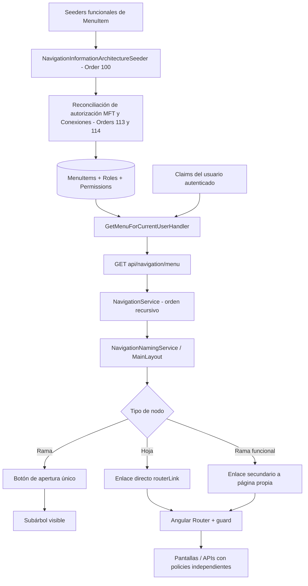

# Arquitectura de navegación SPA y administración MFT

**Decisión `ADR-NAV-UX-MFT-001` | 2026-10-27 | Implementada en fuentes; runtime pendiente**

## 1. Arquitectura en capas



El backend **no** deduce autorización de las etiquetas. Las etiquetas son presentación; `MenuItemRole` y `MenuItemPermission` gobiernan visibilidad y el guard Angular/API gobierna acceso a recursos. La navegación no constituye control de seguridad suficiente.

## 2. Modelo de interacción uniforme

| Elemento | Visual | Acción | Teclado / accesibilidad |
| --- | --- | --- | --- |
| Hoja funcional | Fila normal | Navega | Enlace (`a`), `aria-current` en destino activo |
| Grupo estructural | Fila con flecha | Expandir / contraer | `button` fila completa; `aria-expanded`, `aria-controls` |
| Grupo con landing | **Misma fila con flecha** y acción secundaria de destino | Fila expande / contrae; icono lateral navega a landing | `button` para expandir; `a` con `aria-label="Abrir página de …"` |
| Escritorio compacto | Iconos, etiquetas ocultas | Al activar grupo se expande primero el sidebar y luego el grupo | Tooltip, control principal conserva identidad/semántica |
| Móvil | Drawer overlay | Expandir no cierra; navegar sí cierra | Escape/backdrop y retorno de foco al disparador |

Política de expansión: **múltiples grupos pueden permanecer abiertos**; la ruta activa abre sus ancestros automáticamente. No introducir un acordeón de apertura exclusiva como parte de este ajuste. Los nodos son dinámicos y se identifican por `item.id`. No mantener lista de rutas hardcodeada en Angular.

## 3. Árbol objetivo relevante

```text
Administración de parámetros (/administracion-parametros) [grupo]
└── Conexiones (/integraciones) [grupo / landing si existe]
    ├── Contrato del servicio (/integraciones/contrato)
    ├── Relación de información (/integraciones/relacion-informacion)
    ├── Conexión entidad participante (/integraciones/conexion)
    └── Administración de transferencias de archivos (MFT) (/administracion/mft-ach)
```

`Administración` (`/administracion`) es **otro** grupo del árbol canónico: no duplicar MFT allí para evitar rutas visibles repetidas y divergencia entre ítems. El camino jerárquico aprobado se conserva. Los grupos funcionales que incluyan páginas de destino (por ejemplo `Reportes`) obtienen enlace secundario, sin alterar su jerarquía.

## 4. Seguridad específica de MFT

| Superficie | Política actual conservada |
| --- | --- |
| Menú hijo MFT | `Config.Read OR CanReadAch` después de seeder de seguridad |
| Grupo padre Conexiones | Unión necesaria para los hijos (`CanManageUsers OR Config.Read OR CanReadAch`), sin `MenuItemRole` directo |
| Ruta SPA `/administracion/mft-ach` | `permissionGuard` con `Config.Read` **o** `CanReadAch` |
| APIs de lectura | Policies `P1.ConfigRead` en endpoints existentes |
| Actualización de configuración | Policies de gestión existentes (`P1.ConfigManage` y guardas funcionales), **no** se amplían |

La reconciliación se realiza en los seeders existentes `MftAdministrationMenuAuthorizationSeeder` y `ConnectionsStructuralMenuAuthorizationSeeder`. No se modifica la autorización en este paquete. Si MFT no aparece en un entorno desplegado, primero verificar que ambos seeders corrieron y que los claims del usuario coinciden con la política. No dar acceso por simple visibilidad.

## 5. Decisiones y no-objetivos

- `DEC-001`: un mismo botón para todas las ramas; no mezclar «clic fila navega» con «clic fila expande».
- `DEC-002`: el destino propio de un padre se mantiene accesible desde enlace lateral con nombre ARIA; las hojas siguen siendo enlaces normales.
- `DEC-003`: seed canónico es fuente de verdad para ubicación, orden y label; no crear ramas MFT estáticas en Angular.
- `DEC-004`: usar el acrónimo **MFT** en el título de esta pantalla porque identifica inequívocamente la función solicitada; otras etiquetas no cambian.
- `DEC-005`: nunca modificar permisos ni semántica de los ciclos ACH/CENIT en un cambio exclusivamente de navegación.
- `DEC-006`: `NAV-MENU-IA-001/NAV3.5C` mantiene el bloqueo histórico documentado; el nuevo programa no autoriza cambios IAM.
- `DEC-007`: este paquete se califica `IMPLEMENTED_RUNTIME_PENDING` hasta pasar pruebas Angular/.NET/E2E sobre artefacto exacto.

## 6. Archivos responsables

- SPA layout: `web/ach-interbank-ui/src/app/layout/main-layout.component.{html,scss,ts}`.
- Servicio: `web/ach-interbank-ui/src/app/core/services/navigation.service.ts` (sin cambios).
- Clasificación padre: `web/ach-interbank-ui/src/app/core/services/menu-route-surface.service.ts` (sin cambios).
- Backend: `src/Cfa.ACHInterbank.Persistence/Navigation/Seeders/NavigationInformationArchitectureSeeder.cs`, `AchColombiaMftAdministrationMenuSeeder.cs`.
- Seguridad: `src/Cfa.ACHInterbank.Persistence/Security/Seeders/{MftAdministrationMenuAuthorizationSeeder,ConnectionsStructuralMenuAuthorizationSeeder}.cs` (sin cambios).
- Ruta: `web/ach-interbank-ui/src/app/app-routing.module.ts`.
- Pruebas: `main-layout.component.spec.ts` y tests `NavigationMenuNav22*`, `NavigationMenuNav34M*`, `NavigationMenuNav34N*`.

## 7. Nota de integración con manuales

Esta mejora trata únicamente de UX y navegación administrativa del proyecto; los manuales de ACH Colombia y CENIT del contexto siguen siendo fuentes regulatorias/operativas separadas. No se reinterpretan requisitos de NACHA-M, ventanas de compensación, tipos de transacción ni causales de rechazo/devolución.

## Addendum I05 — consistencia semántica en vista compacta

En el diseño original I01 el subárbol no se renderizaba cuando el lateral estaba compacto, pero `isItemExpanded()` indicaba únicamente que su ID se había guardado en `expandedItems`. Esto podía exponer `aria-expanded=true` mientras no había hijos visibles. I05 separa **expansión persistida** (`expandedItems`, para restauración) de **expansión efectiva** (`isItemExpanded()`, para el template, indicador y ARIA) y usa la expansión efectiva como condición única de renderizado. El botón continúa mostrando el mismo patrón de interacción y no modifica la navegación por rutas.

La línea base I05 se inmoviliza mediante comparación SHA-256 del ZIP I04A padre y el control de conservación de archivos. No se modifica el reconciliador de menú, la ruta `/administracion/mft-ach`, sus permisos ni el dominio financiero. Detalle en `docs/ai/spa-navigation-unification/BASELINE_LINEAGE_I05.md`.

## I06 — Propiedad de estilos de navegación

El sidebar es propietario de los tokens de fondo y texto de navegación (`--shell-nav-*`) y sus estados hover/focus/active. El sistema global de botones (`_components.scss`) excluye los botones `mat-list-item` porque Angular Material no garantiza que todos tengan `.mat-mdc-button-base`. El fondo primario configurable de un botón de formulario no puede sobrescribir el contraste del menú. El estilo final debe validarse por navegador en marcas claras/oscuras y perfiles autorizados; no implica nueva ruta ni cambio en IAM/MFT.
