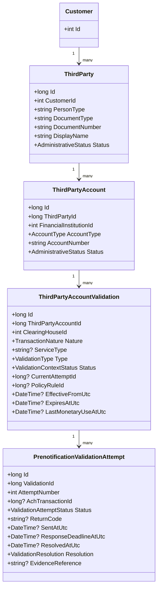
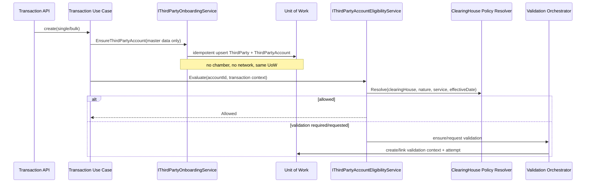

# ACHInterbank — Arquitectura de Administración de Terceros, Cuentas y Validaciones

**Programa:** `TPA-GOV-001`  
**Estado inicial:** `PLANNED`  
**Fecha de corrección de diseño:** 2026-10-11  
**Cámaras actuales:** ACH Colombia V35 y CENIT

## 1. Decisión central corregida

El **onboarding de tercero y cuenta es genérico y agnóstico de cámara**. La cámara no forma parte de la identidad del tercero ni de la cuenta y no debe participar en sus claves naturales, en su creación silenciosa ni en su alta manual.

La cámara aparece **después del onboarding**, cuando una operación necesita evaluar si esa cuenta puede usarse bajo un contexto operacional concreto y, si aplica, iniciar o consultar una validación interbancaria.

El modelo canónico queda separado en tres responsabilidades:

1. **Master Data**: `Customer -> ThirdParty -> ThirdPartyAccount`.
2. **Validation**: validaciones/intentos contextualizados por cámara, naturaleza, servicio y regla efectiva.
3. **Eligibility**: decisión derivada en tiempo de ejecución a partir de maestro + política efectiva + historial de validación + restricciones internas.

El onboarding silencioso existente en creación individual y masiva de transacciones **es un invariante del producto**. Se mantiene y se centraliza; no se sustituye por pre-registro manual obligatorio.

## 2. Mapeo de lenguaje

| Producto | ACH/CENIT | Nota de diseño |
|---|---|---|
| Cliente | Usuario Originador / Originador | Cliente del banco que ordena la operación. |
| Tercero | Usuario Receptor / Receptor | Persona natural o jurídica relacionada con el cliente. |
| Cuenta del tercero | Cuenta Receptora | Cuenta/depósito del tercero en la entidad receptora. |
| Banco del cliente | Participante/Entidad Originadora | Contexto transaccional. |
| Banco del tercero | Participante/Entidad Receptora | Parte de la cuenta maestra. |
| Prenotificación | Transacción no monetaria de validación | Evidencia operacional, no identidad de la cuenta. |

## 3. Principios de arquitectura

1. **Clean Architecture**: Domain define invariantes; Application casos de uso/puertos; Persistence implementa EF/repositorios; API adapta HTTP; Angular consume contratos.
2. **SOLID**: onboarding, política, elegibilidad, validación y transacción tienen responsabilidades separadas.
3. **Onboarding agnóstico de cámara**: `IThirdPartyOnboardingService` no recibe `ClearingHouseId`, `TransactionNature`, PPD/CCD/CTX, ciclos ni causales.
4. **Política efectiva por cámara**: ACH Colombia y CENIT se resuelven únicamente en elegibilidad/validación mediante autoridad efectiva existente.
5. **Branch by Abstraction**: esquema aditivo, compatibilidad con `CustomerThirdParty`, dual-write controlado, shadow compare y cutover posterior.
6. **Idempotencia**: la misma identidad funcional no duplica tercero/cuenta, aun si llega por single, bulk, manual, prenotificación o monetaria.
7. **Historial append-only**: una nueva prenotificación crea un nuevo intento; no se sobrescribe la evidencia previa.
8. **Sin I/O externo en onboarding**: sólo persistencia local dentro de la unidad de trabajo actual.
9. **Fail closed sólo donde la política lo exige**: débito obligatorio no opera sin prerequisito válido.
10. **Crédito opcional no se vuelve obligatorio por software**.
11. **Elegibilidad derivada**: no persistir un booleano global `Eligible/Active` como autoridad universal.
12. **Privacidad**: cuenta/documento enmascarados por defecto; PII sólo bajo permiso y necesidad real.

## 4. Contexto actual a preservar

El baseline contiene:

- onboarding silencioso de `Customer`/`CustomerAccount` en `AchTransactionService` y `AchBulkTransactionService`;
- `PrenotificationHandler`, que crea/vincula `CustomerThirdParty` en prenotificaciones;
- sincronización automática de `CustomerThirdParty` desde `AchStateTransitionService`;
- UI `/customer-third-parties` de consulta y trazabilidad;
- `ClearingHouseTransactionRule` como autoridad efectiva de reglas por cámara;
- `TransactionPrerequisitePolicyService` para prerequisitos;
- aceptación tácita vía `AchTacitAcceptanceJobHandler`;
- selector SPA que hoy depende de `CustomerThirdParty.Status=Active`.

TPA0 sólo caracteriza este comportamiento. No lo cambia.

## 5. Modelo canónico objetivo



### 5.1 Qué pertenece al maestro

`ThirdParty` y `ThirdPartyAccount` contienen únicamente información canónica del tercero y de su cuenta:

- identidad del tercero;
- nombre/razón social;
- entidad financiera receptora;
- tipo de cuenta;
- número de cuenta;
- estado administrativo y auditoría.

**No contienen** `ClearingHouseId`, naturaleza crédito/débito, PPD/CCD/CTX, deadline, ciclo, Rxx, prenotificación ni estado interbancario.

### 5.2 Qué pertenece a validación

`ThirdPartyAccountValidation` representa un **contexto operacional de validación**, no un registro de onboarding. Se crea sólo cuando una política o una acción explícita requiere/solicita validación.

Contexto mínimo:

- cuenta canónica;
- cámara;
- naturaleza de la operación;
- servicio cuando aplique;
- tipo de validación;
- regla/política efectiva utilizada;
- vigencia/expiración cuando exista autoridad normativa.

`PrenotificationValidationAttempt` conserva cada intento de forma append-only.

### 5.3 Elegibilidad

La autoridad de uso se calcula, no se copia a la cuenta:

```text
ThirdPartyAccount master
        +
Effective clearing-house policy
        +
Validation history/current validation context
        +
Internal bank restrictions
        =
EligibilityDecision
```

Decisiones sugeridas:

`Allowed | AllowedWithoutPrenotification | RequiresPrenotification | PrenotificationPending | ValidationExpired | Rejected | Blocked | Unsupported`

Un read model `ThirdPartyAccountOperationalState` puede existir por rendimiento, pero será **proyección derivada y reconstruible**, nunca fuente de verdad ni parte del onboarding.

## 6. Onboarding silencioso objetivo



### 6.1 Contrato del servicio de onboarding

Puerto recomendado:

```csharp
Task<ThirdPartyAccountRef> EnsureAccountAsync(
    ThirdPartyOnboardingRequest request,
    CancellationToken cancellationToken);
```

`ThirdPartyOnboardingRequest` contiene únicamente:

```text
CustomerId
ThirdParty: IdentificationType, IdentificationNumber, DisplayName, PersonType
Account: FinancialInstitutionId, AccountType, AccountNumber
SourceMetadata opcional: Manual | SingleTransaction | BulkTransaction | Backfill
```

No admite campos de cámara.

### 6.2 Single/Bulk/manual convergen

```text
Single transaction ─┐
Bulk transaction   ├──> IThirdPartyOnboardingService
Manual admin       ┘
```

La convergencia evita tres implementaciones distintas de identidad, normalización y concurrencia.

## 7. Identidad e idempotencia

Clave funcional de tercero propuesta:

`CustomerId + DocumentType(normalized) + DocumentNumber(normalized)`

Clave funcional de cuenta propuesta:

`ThirdPartyId + FinancialInstitutionId + AccountType + AccountNumber(normalized)`

La cámara **no** participa en ninguna de las dos.

Si dos transacciones concurrentes crean la misma cuenta, el flujo debe tolerar conflicto de unique key con re-read idempotente, sin retry ciego sobre el resto de la transacción.

## 8. Validación por cámara sin contaminar el maestro

La cámara entra únicamente al evaluar una operación o solicitar una validación:

```text
Evaluate(accountId,
         clearingHouseId,
         transactionNature,
         serviceType,
         effectiveDate,
         transactionContext)
```

- ACH Colombia y CENIT permanecen aisladas por política efectiva.
- Las reglas no se copian entre cámaras.
- Una cuenta registrada por primera vez durante una operación ACH Colombia puede reutilizarse en una operación futura CENIT sin crear otro maestro.
- Lo que puede variar es la necesidad, vigencia o resultado de validación para ese contexto.

## 9. Política normativa

`ClearingHouseTransactionRule` se conserva como autoridad primaria para requisitos de prenotificación/identificación. Si TPA0 demuestra dimensiones faltantes, se extiende de forma genérica y effective-dated; no se crea una segunda tabla paralela.

Campos candidatos sólo si existe evidencia aprobada:

- `PrenotificationResponseWindowMode`;
- `PrenotificationResponseDeadlineRule`;
- `MinimumElapsedCycles`;
- `ValidationRetentionMonthsAfterLastMonetaryUse`;
- `TacitAcceptanceEnabled`.

## 10. Estados

### Maestro

`Draft | Active | Inactive`

No equivalen a validación interbancaria.

### Contexto de validación

`NotStarted | PendingSend | PendingResponse | Validated | Rejected | Expired | Suspended`

`NotRequired` debe ser una **decisión de elegibilidad/política**, no un estado permanente de la cuenta.

### Intento

`Created | Queued | Sent | AwaitingResponse | Accepted | Rejected | Failed | Cancelled`

Sólo el procesamiento automático de respuesta/aceptación tácita puede producir `Accepted/Rejected` interbancario.

## 11. API/UX de alto nivel

- CRUD de tercero/cuenta es genérico y no pide cámara.
- Solicitar prenotificación/validación sí requiere contexto de cámara/naturaleza/servicio.
- La UI presenta identidad/cuentas por un lado y “Validaciones operativas” por otro.
- El selector de transacciones consulta elegibilidad contextual, no `Active` global.
- No existe botón/API “Aprobar tercero” para resultados interbancarios.

## 12. Resiliencia

- onboarding: transacción local, idempotente, sin red;
- policy resolution: determinista y local;
- creación de intento: idempotency key interna por request/transaction cuando corresponda;
- envío NACHA: conserva pipeline existente y sus garantías;
- respuestas: correlación e idempotencia antes de mutar estado;
- jobs: cluster-safe según patrones actuales;
- no retry ciego de efectos monetarios/no idempotentes.

## 13. Estrategia de migración

1. characterizar legacy;
2. agregar maestro genérico y validación contextual de forma aditiva;
3. centralizar onboarding genérico single/bulk/manual;
4. integrar validaciones por política;
5. backfill idempotente;
6. shadow compare;
7. cutover de lectura/selector;
8. decidir retiro de `CustomerThirdParty` en fase separada.

## 14. No objetivos

- no rediseñar NACHA-M;
- no inventar un DMS para soportes de autorización;
- no introducir una tercera autoridad de reglas;
- no convertir onboarding en proceso dependiente de ACH Colombia/CENIT;
- no eliminar `CustomerThirdParty` antes del cutover verificado;
- no modificar resultados normativos sin fuente.
